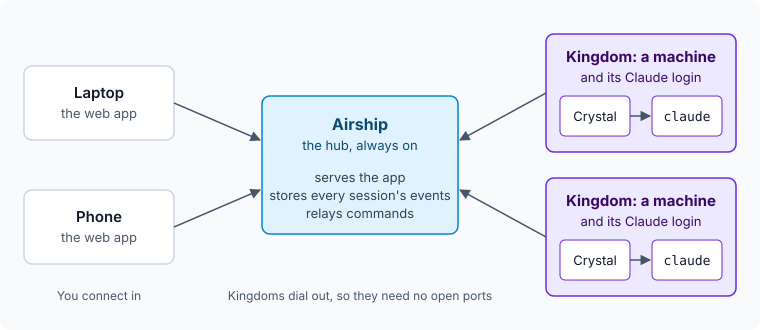

# How it fits together

Crystal Bridge has one hub and any number of machines. You talk to the hub, and the hub passes your messages to the
machine doing the work. This page explains those parts and the words the app uses for them, which the rest of these
guides assume.

## The parts

- **The Airship** is the hub. It's one small server on an always-on host. It serves the web app, stores what every
  session does, and relays messages. It doesn't run Claude itself, and it holds no Claude credentials.
- **A Kingdom** is a machine you run Claude Code on, together with the Claude account signed in there. Two machines can
  use one account or separate ones.
- **The Crystal** is the small agent on each Kingdom. It runs the real `claude` CLI, and connects out to the Airship, so
  a Kingdom needs no open ports.
- **The web app** works in any current browser, on a laptop or a phone. You can
  [install it as an app](./INSTALL-APP.md).

To try it, all of these can run on one computer. See [Getting started](./GETTING-STARTED.md).

## What happens in a session

The app calls a session a **Quest**.

1. You start a Quest on a Kingdom from the web app. The Airship passes that on to the Kingdom's Crystal.
2. The Crystal runs `claude` in the project you picked, under that machine's own login.
3. Everything Claude does streams back through the Airship to your browser, and the Airship keeps a copy, so you can
   close the tab and pick the session up later from another device.
4. When Claude needs permission, or has a question, a card appears in the app and a notification goes to your devices.
   Your answer goes back the same way, and Claude carries on.

Each Claude agent in a Quest is a **Hero**. The leader runs the Quest, and subagents join the party for a task. Heroes
gain pointless levels as you use them.

## The words

The default theme has its own word for everything, and a tooltip gives the plain term. If you'd rather not have any of
this, the Classic theme uses plain words throughout. See [Themes and art packs](./THEME.md).

<!--@include: ../README.md#the-world-->

## Next

- [Try it on one machine](./GETTING-STARTED.md), which takes a couple of minutes.
- See what the hub keeps in [the security model](./SECURITY-MODEL.md) and [what it stores](./HUB-DATA.md).
- Read [how a Kingdom runs Claude Code](./ENGINES.md) for the protocol underneath.
