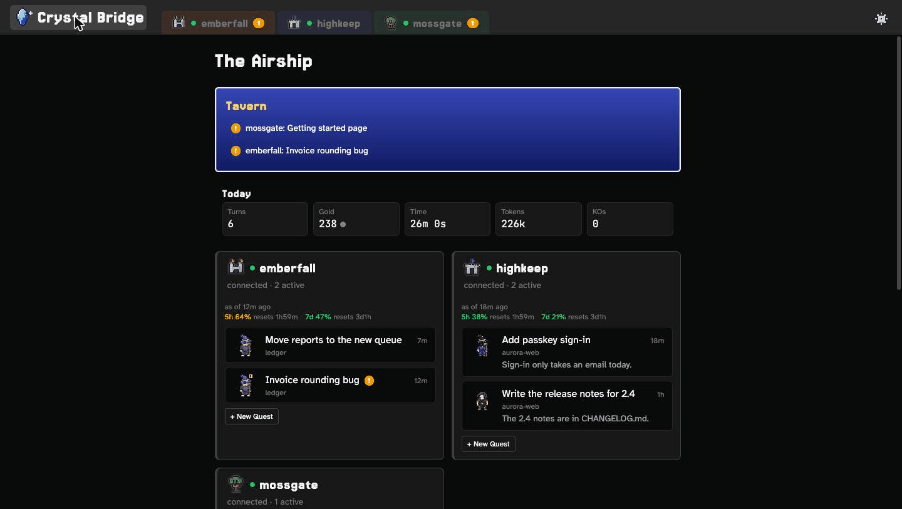

A tour of the app, running a scripted world of invented machines.

## Who it's for

Crystal Bridge is for you if you run Claude Code on more than one machine, or on one machine you aren't always sitting
at. You might keep a repository on a home server, a work account on another computer, and want to check on both from the
sofa. Instead of opening terminals, you open one app.

It's a personal project, and you host it yourself. [Try it on one machine](./GETTING-STARTED.md), then read
[how it fits together](./CONCEPTS.md).
